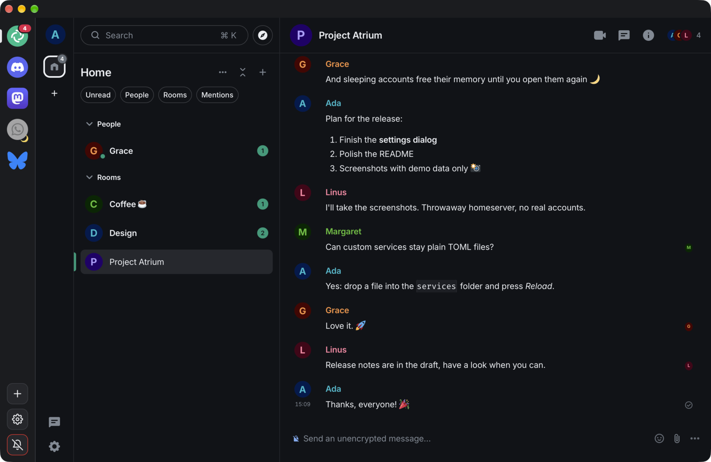

<p align="center">
  
</p>

<h1 align="center">Atrium</h1>

<p align="center"><em>All your messengers in one calm place.</em></p>

<p align="center">
  
</p>

Atrium is a lightweight messenger aggregator for macOS and Linux. It puts Element, Slack, Discord, WhatsApp, Teams and any other web app into one window with a compact sidebar. Every account runs in its own isolated web view, so you can stay signed in to several accounts of the same service side by side.

It is written in Rust on top of [Tauri v2](https://v2.tauri.app/) and uses the system's WebKit (WebKitGTK on Linux) instead of bundling Chromium. Release builds exist for macOS and Linux (x86_64 and aarch64 AppImages); see [Linux](DEVELOPMENT.md#linux) in DEVELOPMENT.md for building from source. Windows support is in progress; see [Windows](DEVELOPMENT.md#windows) in DEVELOPMENT.md for building it from source.

## Features

- **One window, many accounts.** A sidebar of service icons with unread badges.
  - Reorder accounts with drag and drop.
  - Pick small, medium or large icons.
- **Isolated sessions.** Each account has its own persistent WebKit data store (cookies, storage, caches), e.g. two Slack workspaces or a work and a private Element account.
- **Notifications.**
  - Native notifications; clicking one jumps to the right account.
  - Dock badge and menu bar icon with the total unread count (launcher badge and tray icon on Linux).
  - Do Not Disturb, and per-account mute.
  - Optional hiding of message text.
- **Sleep.**
  - Inactive services can be put to sleep automatically, globally or per account, to free memory.
  - Sleeping accounts are shown greyed out with a moon.
  - An account can start asleep, so it only loads when you select it.
- **Links.**
  - Links open in your browser of choice, or in an app window that shares the account's login.
  - Sign-in popups (SSO/OAuth) always stay in the app.
  - Per account, you can list hosts that always open in the app, e.g. your single-sign-on provider.
- **Icons.** Site favicons are fetched automatically. You can also use a [Simple Icons](https://simpleicons.org/) glyph or your own image.
- **Customisable.**
  - Per account: zoom, user agent, custom CSS, camera and microphone permission, enable/disable, force reload without the cache.
  - Custom services can be created in the settings, optionally starting from a built-in one.
  - **Expert mode:** edit service definitions as TOML files in the services folder and reload them without restarting.
- **Desktop integration.**
  - Keyboard shortcuts: an app menu on macOS, window shortcuts on Linux.
  - Launch at login, start hidden, keep running in the background.
  - After you wake your computer from sleep, reload only the services that stopped responding, or all of them, per account (on macOS not on Power Nap background wakes; on Linux after a resume from suspend).

## Built-in services

| Service | Notes |
|---|---|
| Element / Matrix | Any Element web host (default `app.element.io`). |
| Slack | |
| Microsoft Teams | |
| Discord | |
| WhatsApp | |
| Rainbow | |
| LinkedIn | Messaging |
| Mastodon | Any instance |
| Bluesky | |

Anything else can be added as a custom service: a name, a URL, and optionally a title pattern for unread counts.

## Screenshots

| Account settings | General settings |
|---|---|
|  |  |
| **Custom services** | |
|  | |

The screenshots use a local demo Matrix server with made-up users (see [DEVELOPMENT.md](DEVELOPMENT.md#screenshots)).

## Installation

On macOS, download `atrium-macos-arm64.zip` (Apple silicon) or `atrium-macos-x86_64.zip` (Intel) from the [latest release](https://github.com/dfuchss/atrium/releases/latest), unzip it and move `Atrium.app` to the Applications folder.

The builds are not signed, so macOS blocks the first start: open Atrium once, then allow it in System Settings → Privacy & Security → *Open Anyway*. If macOS reports the app as "damaged", remove the download quarantine with `xattr -cr /Applications/Atrium.app`.

On Linux, download `atrium-linux-x86_64.AppImage` (or `atrium-linux-aarch64.AppImage` on 64-bit ARM), make it executable (`chmod +x`) and run it; see [Linux](#linux) for FUSE and the launcher entry.

### Updates

Atrium checks for a new release on startup and every six hours (Settings → About; the check can be switched off there). An update is downloaded, verified against the release's `SHA256SUMS` and placed next to the app; *Restart and update* quits Atrium, swaps in the new version and starts it again. This works only for an Atrium in `/Applications` or `~/Applications`; development builds and other locations just point to the release page.

On Linux, an Atrium started as an AppImage updates itself the same way, except that *Quit and update* only quits Atrium and swaps in the new AppImage under the same file name; open Atrium again afterwards. The AppImage must lie in a folder you can write to (e.g. `~/Applications`); builds from source just point to the release page.

To build Atrium yourself, see [Building from source](DEVELOPMENT.md#building-from-source) in [DEVELOPMENT.md](DEVELOPMENT.md).

### Linux

Releases include AppImages for x86_64 and aarch64 (`atrium-linux-x86_64.AppImage`, `atrium-linux-aarch64.AppImage`): make it executable and run it (it needs FUSE 2, see below). To build from source, see [Linux](DEVELOPMENT.md#linux) in DEVELOPMENT.md.

Running it needs FUSE 2 (`libfuse2` on Debian/Ubuntu, `fuse` on Fedora), or start it with `--appimage-extract-and-run`.

The window icon and launcher entry come from a desktop entry that matches the window's app id `org.fuchss.atrium`: by its name, `org.fuchss.atrium.desktop`, or by `StartupWMClass=org.fuchss.atrium`. The AppImage contains one (`atrium.desktop`, matched by its `StartupWMClass`), which an AppImage manager such as Gear Lever installs. Without one, open Settings > General > Desktop integration in the running AppImage and press **Install** (it writes `~/.local/share/applications/org.fuchss.atrium.desktop` and the icons `org.fuchss.atrium.png` below `~/.local/share/icons/hicolor/`); **Update** points the entry at the AppImage again after you moved it, and **Uninstall** removes the entry and these icons.

Data locations on Linux:
- **Config:** `~/.config/org.fuchss.atrium/` (`accounts.json`, `services/`)
- **Web data (per account):** `~/.local/share/org.fuchss.atrium/webdata/<account id>/`. WebKitGTK keeps the cookies there as plain text, and its content processes run without WebKit's bubblewrap sandbox, so a page that breaks out of one could read the web data of every account. The WebKit bundled in the AppImage looks for `bwrap` inside the AppImage and stops Atrium if the sandbox is turned on.
- **Log:** the app log folder, `~/.local/share/org.fuchss.atrium/logs/atrium.log`

Known limitations on Linux:
- JavaScript dialogs name the host of the page, not of an embedded frame that asks (WebKitGTK does not tell which frame asked).
- There is no app menu; the keyboard shortcuts work with <kbd>Ctrl</kbd> instead of <kbd>⌘</kbd>. They take precedence over a page's own shortcuts with the same keys (for example <kbd>Ctrl</kbd><kbd>R</kbd> or <kbd>Ctrl</kbd><kbd>1</kbd> in a web app).
- The unread count appears as the tray label only where the panel supports it. The launcher badge works only where the desktop supports the Unity launcher API.
- Settings > Links > Browser lists the installed browsers; a command name saved by an earlier build is not recognised and links open in the system default browser.
- *Auto* appearance starts light and follows the desktop's light or dark colour scheme only once it changes while Atrium runs ([tao#1378](https://github.com/tauri-apps/tao/issues/1378)); such a change also overrides Light or Dark ([tao#1382](https://github.com/tauri-apps/tao/issues/1382)). A GTK theme named `*-dark` also keeps pages dark when Light is selected.
- On Wayland, starting Atrium again may only highlight the running Atrium in the task bar instead of bringing its window to the front.
- Session cookies are stored unencrypted in the per-account web data folder (mode `0700`): exclude `webdata/` from backups and sync.

## Usage

- **Add accounts** with the **+** button at the bottom of the sidebar. The settings dialog stays open, so you can add several in a row. Drag icons to reorder them.
- **Settings** (gear button or <kbd>⌘</kbd><kbd>,</kbd>):
  - Accounts
  - Custom services
  - General
  - Notifications
  - Dock badge (Launcher badge on Linux)
  - Links
  - About

| Shortcut | Action |
|---|---|
| <kbd>⌘</kbd><kbd>,</kbd> | Open the settings |
| <kbd>⌘</kbd><kbd>1</kbd> … <kbd>⌘</kbd><kbd>9</kbd> | Switch to account 1–9 |
| <kbd>⌘</kbd><kbd>R</kbd> | Reload the current account |
| <kbd>⌘</kbd><kbd>[</kbd> / <kbd>⌘</kbd><kbd>]</kbd> | Back / forward |
| <kbd>⌘</kbd><kbd>=</kbd> / <kbd>⌘</kbd><kbd>-</kbd> / <kbd>⌘</kbd><kbd>0</kbd> | Zoom in / out / reset (per account) |
| <kbd>⌘</kbd><kbd>⇧</kbd><kbd>O</kbd> | Open the current page in the browser |
| <kbd>⌘</kbd><kbd>W</kbd> | Close the window (Atrium keeps running in the background) |
| <kbd>⌘</kbd><kbd>Q</kbd> | Quit |

On Linux, use <kbd>Ctrl</kbd> where the table says <kbd>⌘</kbd> (and <kbd>Shift</kbd> for <kbd>⇧</kbd>); they work while a service has the focus. <kbd>Ctrl</kbd><kbd>+</kbd> zooms in as well.

### Service definitions (expert mode)

Settings → Custom services → *Open folder* opens `~/Library/Application Support/org.fuchss.atrium/services/`. Every `*.toml` file there defines a service, in the same format as the built-in ones in [`services/`](services). A file with the id of a built-in service overrides it. The same tab lists the files and edits them in the app: *Edit*, *New definition* (starts from the documented template), *Disable*/*Enable* (renames to `.toml.disabled`) and *Delete*. The editor checks the text with the loader's own rules while you type, shows errors with line and column, refuses to save an invalid file and applies a saved file right away. Edits made outside the app need *Reload*.

```toml
id = "forum"
name = "Team Forum"
color = "#0EA5E9"
url = "https://{instance}/"             # {instance} is asked for per account
instance_label = "Forum host"
user_agent = "webkit"               # webkit | chrome | default | any literal UA
internal_hosts = ["{instance}"]

[unread]
title_regex = '^\((\d+)\)'          # capture group 1 = unread count
```

`{instance}` stands for the part of the URL that differs per account, e.g. the server host of a self-hosted service or a workspace subdomain. Each account of the service asks for it (labelled with `instance_label`, pre-filled with `instance_default`), and it can be used in `url` and `internal_hosts`.

## Privacy and security

- **Isolation:** every service view runs in its own WebKit content process (sandboxed on macOS, see [Linux](#linux)) with its own data store. Service pages get **no access** to Atrium's internal API.
- **Minimal script injection:** Atrium injects only a small script that forwards web notifications and routes new-window links, plus optional custom CSS. Unread counts are read from the page title in Rust.
- **Links:** only `http(s)` and `mailto` links are handed to the system, and in-page navigation is limited to web schemes.
- **Local only:** the settings UI runs under a strict Content Security Policy. Atrium has no telemetry and no server; everything stays on your computer. The update check asks the GitHub API for the latest release (with the Atrium version in the user agent); it can be switched off.

## Known limitations

- **Passkeys/WebAuthn don't work** inside embedded WebKit views for third-party sites. Apple restricts this to apps with a special browser entitlement. Use password + TOTP or SSO instead.
- **Some sites don't render in WebKit at all.** If a service stays blank in Safari too, Atrium can't show it either. A Chromium-based engine is on the roadmap.
- **Sleeping services** don't deliver notifications until they are opened again.

## Data locations

- **Config (macOS):** `~/Library/Application Support/org.fuchss.atrium/`
- **Log (macOS):** `~/Library/Logs/org.fuchss.atrium/atrium.log` (readable by you only, rotated to `atrium.log.1` at 5 MB). URLs are logged without query and fragment, page titles not at all.
- **Web data (macOS, per account):** `~/Library/WebKit/org.fuchss.atrium/`
- Linux: see [Linux](#linux).
- Windows: see [Windows](DEVELOPMENT.md#windows) in DEVELOPMENT.md.

## Development

Building from source, the architecture, checks, debug options and releasing: see [DEVELOPMENT.md](DEVELOPMENT.md).

## License

Atrium is free software: you can redistribute it and/or modify it under the terms of the GNU General Public License as published by the Free Software Foundation, either version 3 of the License, or (at your option) any later version. See [`LICENSE`](LICENSE).

Copyright © 2026 Dominik Fuchß
