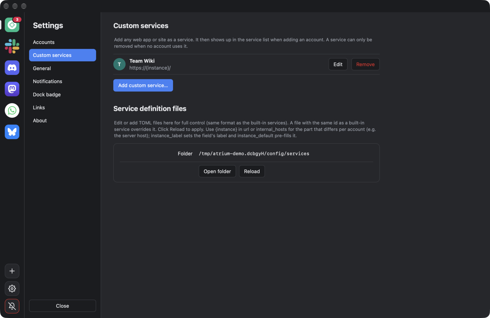

  

<h1 align="center">Atrium</h1>

<em>All your messengers in one calm place.</em>

  

Atrium is a lightweight messenger aggregator for macOS, Linux and Windows. It puts Element, Slack, Discord, WhatsApp, Teams and any other web app into one window with a compact sidebar. Every account runs in its own isolated web view, so you can stay signed in to several accounts of the same service side by side.

It is written in Rust on top of [Tauri v2](https://v2.tauri.app/) and uses the system's web view (WebKit on macOS, WebKitGTK on Linux, WebView2 on Windows) instead of bundling its own browser engine. Windows support is still in progress.

## Features

- One window with a sidebar of accounts, unread badges and native notifications, Do Not Disturb and per-account mute.
- Isolated sessions: each account has its own cookies, storage and caches.
- Inactive services can sleep to free memory.
- Links open in your browser of choice or in an app window that keeps the account's login; sign-in popups stay in the app.
- Per-account zoom, user agent, custom CSS, icon and camera and microphone permission.
- Custom services, and service definitions as TOML files with an in-app editor.
- Keyboard shortcuts, launch at login, background mode, recovery after a wake from sleep and self-updates.
- No telemetry and no server: everything stays on your computer.

All features: [Features](https://github.com/dfuchss/atrium/wiki/Features).

**Built-in services:** Element / Matrix (any host), Slack, Microsoft Teams, Discord, WhatsApp, Rainbow, LinkedIn (messaging), Mastodon (any instance) and Bluesky; what Atrium counts as unread for each is on [Built-in services](https://github.com/dfuchss/atrium/wiki/Services). Anything else can be added as a custom service with a name and a URL.

| Account settings | Custom services |
|---|---|
|  |  |

## Installation

Download the file for your machine from the [latest release](https://github.com/dfuchss/atrium/releases/latest); the builds are not signed, so the first start needs one confirmation.

| Platform | File | Install and first start |
|---|---|---|
| macOS 14+, Apple silicon | `atrium-macos-arm64.zip` | [macOS](https://github.com/dfuchss/atrium/wiki/macOS) |
| macOS 14+, Intel | `atrium-macos-x86_64.zip` | [macOS](https://github.com/dfuchss/atrium/wiki/macOS) |
| Linux, x86_64 | `atrium-linux-x86_64.AppImage` (bundles its libraries) or `atrium-linux-x86_64` (uses the system's) | [Linux](https://github.com/dfuchss/atrium/wiki/Linux) |
| Linux, aarch64 | `atrium-linux-aarch64.AppImage` or `atrium-linux-aarch64` | [Linux](https://github.com/dfuchss/atrium/wiki/Linux) |
| Windows 10 and 11, x86_64 | `atrium-windows-x86_64.exe` | [Windows](https://github.com/dfuchss/atrium/wiki/Windows) |

Atrium updates itself from Settings → About. The changes of every version are in the [changelog](CHANGELOG.md).

## Documentation

The [wiki](https://github.com/dfuchss/atrium/wiki) has the [usage and settings](https://github.com/dfuchss/atrium/wiki/Usage), the [service definitions](https://github.com/dfuchss/atrium/wiki/Service-Definitions), [privacy and security](https://github.com/dfuchss/atrium/wiki/Privacy-and-Security), the [known limitations](https://github.com/dfuchss/atrium/wiki/Known-Limitations) and, per platform, the data locations and platform notes. To build Atrium yourself or to contribute, see [DEVELOPMENT.md](DEVELOPMENT.md).

## License

Atrium is free software: you can redistribute it and/or modify it under the terms of the GNU General Public License as published by the Free Software Foundation, either version 3 of the License, or (at your option) any later version. See [`LICENSE`](LICENSE).

Copyright © 2026 Dominik Fuchß
