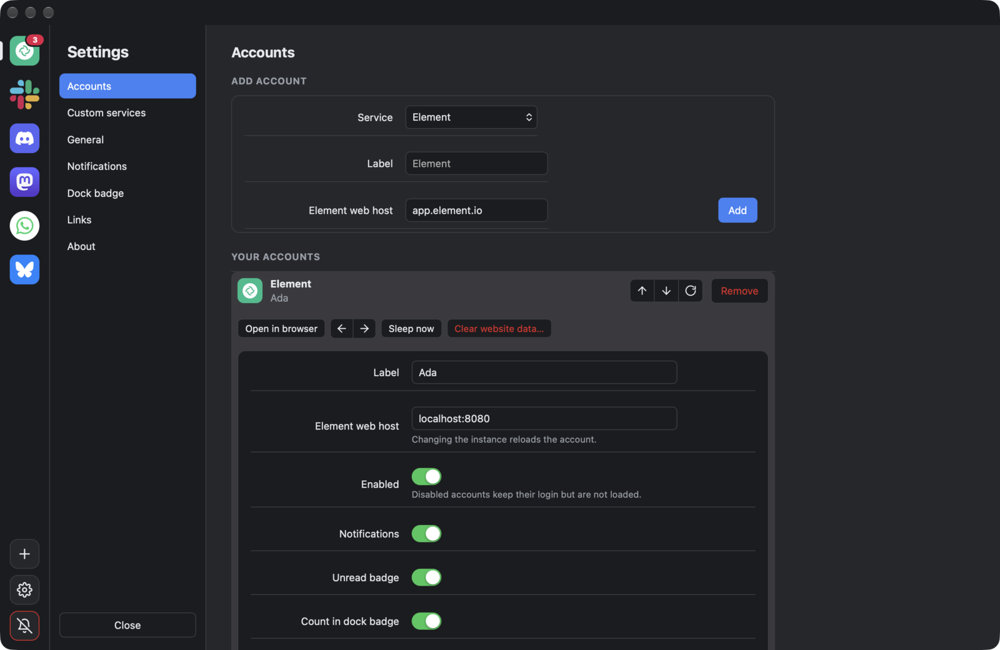
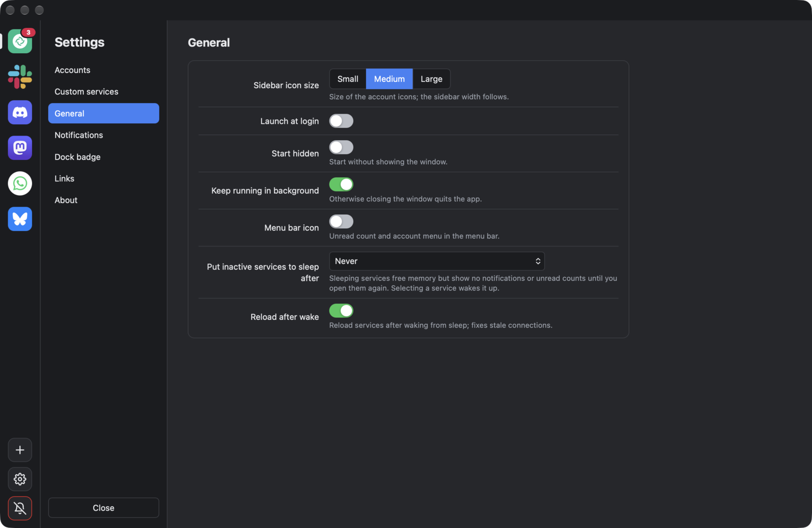
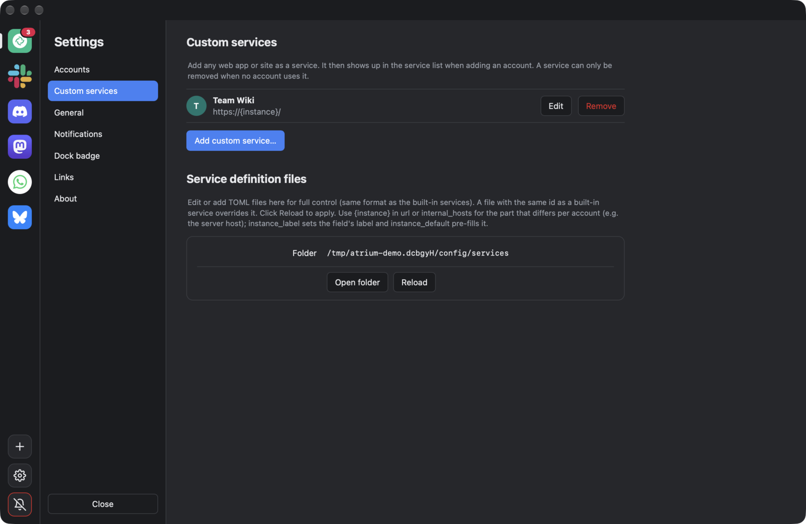

# Features

- **One window, many accounts.** A sidebar of service icons with unread badges.
  - Reorder accounts with drag and drop.
  - Pick small, medium or large icons.
- **Isolated sessions.** Each account has its own persistent web data (cookies, storage, caches), e.g. two Slack workspaces or a work and a private Element account.
- **Notifications.**
  - Native notifications; clicking one jumps to the right account.
  - The total unread count in the Dock badge and menu bar icon on macOS, in the launcher badge and tray icon on Linux; on Windows the taskbar button shows a dot for unread messages.
  - Do Not Disturb, and per-account mute.
  - Optional hiding of message text.
- **Sleep.**
  - Inactive services can be put to sleep automatically, globally or per account, to free memory.
  - Sleeping accounts are shown greyed out with a moon.
  - An account can start asleep, so it only loads when you select it.
- **Links.**
  - Links open in your browser of choice, or in an app window that shares the account's login.
  - Sign-in popups (SSO/OAuth) always stay in the app.
  - Per account, you can list hosts that always open in the app, e.g. your single-sign-on provider.
- **Icons.** Site favicons are fetched automatically. You can also use a [Simple Icons](https://simpleicons.org/) glyph or your own image.
- **Customisable.**
  - Per account: zoom, user agent, custom CSS, camera and microphone permission, enable/disable, force reload without the cache.
  - Custom services can be created in the settings, optionally starting from a built-in one.
  - **Expert mode:** edit [service definitions](Service-Definitions) as TOML files in the services folder and reload them without restarting.
- **Desktop integration.**
  - Keyboard shortcuts: an app menu on macOS, window shortcuts on Linux and Windows (see [Usage](Usage#keyboard-shortcuts)).
  - Launch at login, start hidden, keep running in the background.
  - A launcher entry on [Linux](Linux#desktop-integration) and a Start menu shortcut on [Windows](Windows#desktop-integration), installed from the settings.
  - After you wake your computer from sleep, reload only the services that stopped responding, or all of them, per account (on macOS not on Power Nap background wakes; on Linux after a resume from suspend; on Windows after a resume from sleep or hibernation).
- **Updates.** Atrium [updates itself](Usage#updates) from the GitHub releases, verified against their checksums.

## Built-in services

Element / Matrix (any Element web host), Slack, Microsoft Teams, Discord, WhatsApp, Rainbow, LinkedIn (messaging), Mastodon (any instance) and Bluesky. What Atrium counts as unread for each of them, and their other details, are on [Built-in services](Services).

Anything else can be added as a custom service: a name, a URL, and optionally a title pattern for unread counts.

## Screenshots

| Account settings | General settings |
|---|---|
|  |  |
| **Custom services** | |
|  | |

The screenshots use a local demo Matrix server with made-up users (see [Screenshots](Screenshots)).
