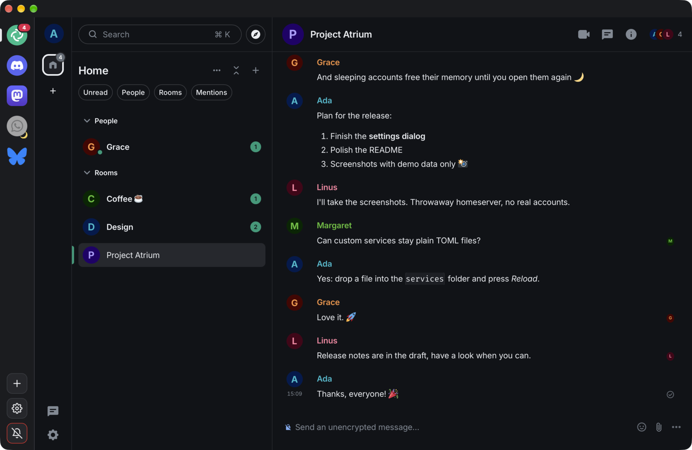

# Atrium

*All your messengers in one calm place.*

Atrium is a lightweight messenger aggregator for macOS, Linux and Windows. It puts Element, Slack, Discord, WhatsApp, Teams and any other web app into one window with a compact sidebar. Every account runs in its own isolated web view, so you can stay signed in to several accounts of the same service side by side.

It is written in Rust on top of [Tauri v2](https://v2.tauri.app/) and uses the system's web view (WebKit on macOS, WebKitGTK on Linux, WebView2 on Windows) instead of bundling its own browser engine.

## Using Atrium

- [Features](Features): what Atrium does, the built-in services and screenshots.
- [Usage](Usage): accounts, settings, keyboard shortcuts and updates.
- [Built-in services](Services): what Atrium counts as unread per service.
- [Service definitions](Service-Definitions): expert mode, services as TOML files.
- [Privacy and security](Privacy-and-Security): what Atrium protects and what it stores.
- [Known limitations](Known-Limitations): what does not work, on every platform.
- [Troubleshooting](Troubleshooting): common problems and where to look.

## Platforms

Install, updates, desktop integration, data locations and limitations per platform:

- [macOS](macOS): macOS 14 or later, Apple silicon and Intel.
- [Linux](Linux): AppImage and plain binary for x86_64 and aarch64.
- [Windows](Windows): Windows 10 and 11, x86_64. Windows support is still in progress.

## Development

- [Building](Building): building from source on macOS, Linux and Windows.
- [Architecture](Architecture): the crates and how they fit together.
- [Checks](Checks): the checks every commit must pass, and the CI builds.
- [Debug options](Debug-Options): environment variables of debug builds.
- [Screenshots](Screenshots): how the screenshots are taken.
- [Releasing](Releasing): versions, the changelog and the release workflow.

The changes of every version are in the [changelog](https://github.com/<<REPO>>/blob/main/CHANGELOG.md).
